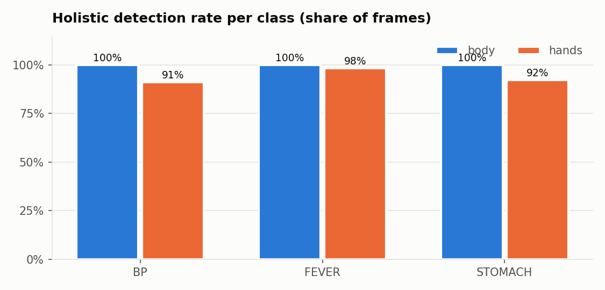
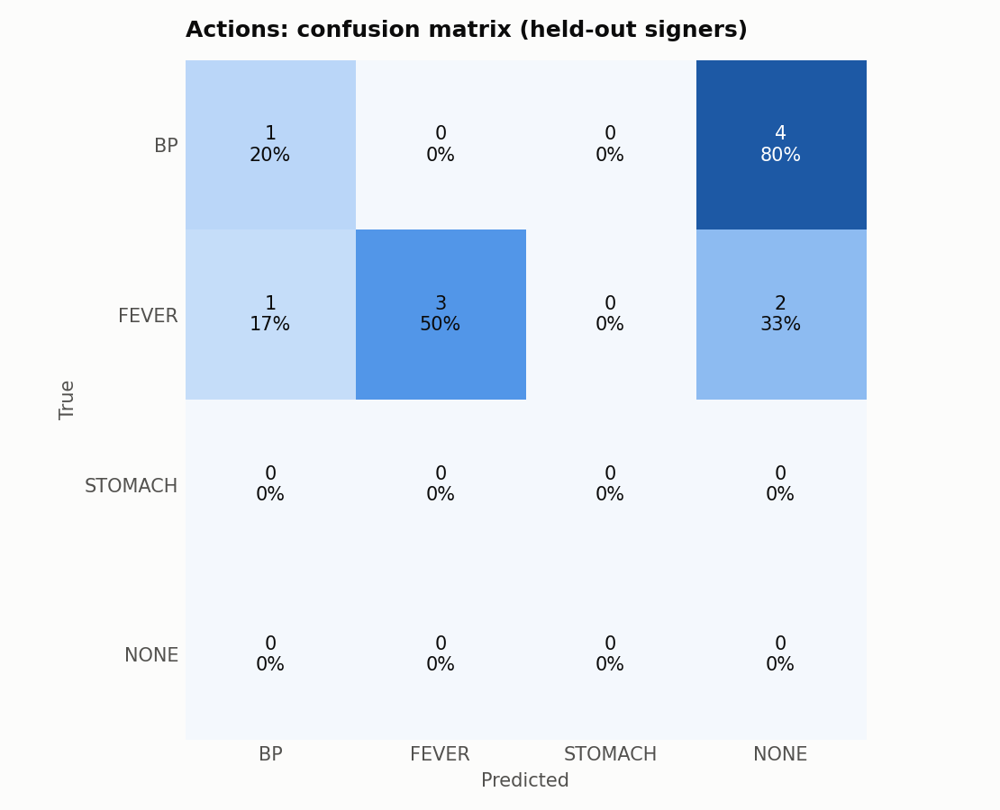
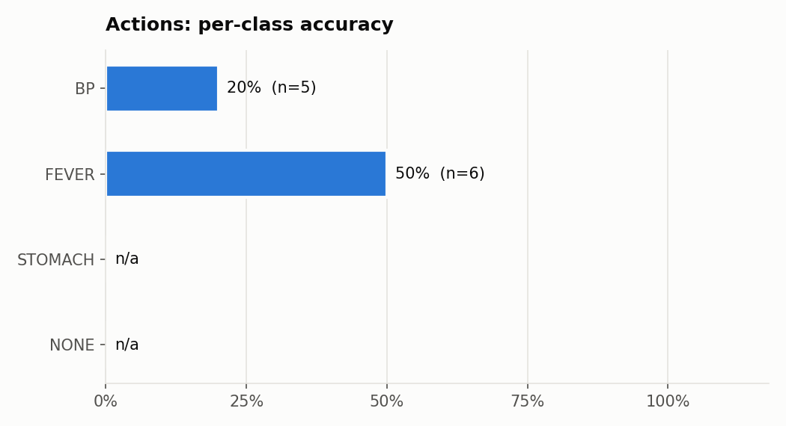
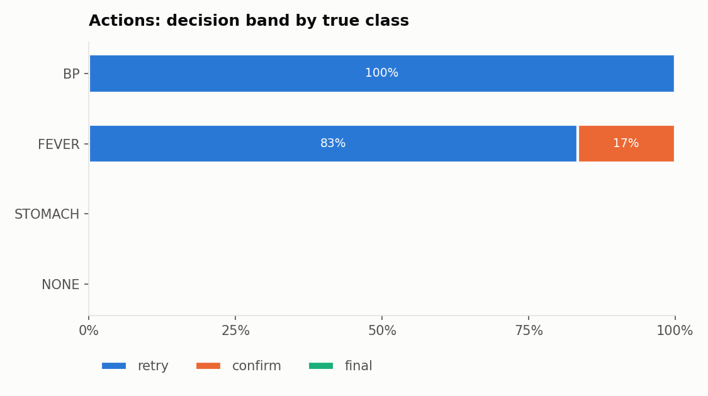

# SignBridge held-out accuracy

Scope: 6 ISL signs only (letters A, B, C; actions BLOOD_PRESSURE, FEVER, STOMACH_ACHE). Not a general ISL translator.

## Letters -> Text (held-out split, calibrated on train only)

**Held-out letter accuracy cannot be measured: the letter library has A: 1, B: 1, C: 1 image(s); at least 4 per letter are needed for a held-out split.**

The app still recognises letters from this library, but its confidence scale and rejection distance are an uncalibrated fallback, not tuned on data.

## Actions -> Text (held-out by signer)

### Holistic detection rate

68/68 clips usable; body visible in 100.0% and a hand in 94.6% of frames overall.

| Class | Clips | Usable | Body | Hands |
|---|---|---|---|---|
| BLOOD_PRESSURE | 13 | 13 | 100.0% | 91.0% |
| FEVER | 30 | 30 | 100.0% | 98.3% |
| STOMACH_ACHE | 25 | 25 | 100.0% | 92.1% |

### Held-out accuracy (leave-one-signer-out)

Each signer is held out in turn and tested against the other signers' clips. Every source video belongs to one signer, so no segment or augmented copy of a test video is ever in training; augmented copies are training-only and never used as test clips. Training folds use the balanced library (at most 3 segments per source video, 2 time-window copies each, no mirror copies). Confidence = ranking x absolute-distance curve; T, the curve and the minimum-motion gate are calibrated on the training signers only.

| Class | Sources (signers) | Held-out accuracy |
|---|---|---|
| BLOOD_PRESSURE | 3: atman, p1, p2 | 20.0% (n=5) |
| FEVER | 2: p1, yt_fever | 50.0% (n=6) |
| STOMACH_ACHE | 1: yt_sdlj | **cannot be measured** - only one source |

> **STOMACH_ACHE: held-out accuracy cannot be measured.** All its clips come from one source (yt_sdlj); when that source is held out, no STOMACH_ACHE clip is left to match against. The clips are still in the app's library, but they are left out of the numbers below. Record the sign by a second person to measure it.

> **No NONE clips.** "Not a known sign" relies only on the calibrated distance curve (a best match far from the typical same-class distance) and the motion gate. Record non-sign movements into `data/actions/NONE/` to measure and improve rejection.

Numbers below cover the measurable classes only (BLOOD_PRESSURE, FEVER). Confidence bands: retry < 60%, confirm top-2 60-85%, final >= 85%.

- **Ranking only** (closest class, before confidence/rejection): 63.6% - BLOOD_PRESSURE 40.0%, FEVER 83.3%
- **Decision** (what the app shows, with confidence bands and rejection):

- Test samples: **11**
- **Top-1 accuracy: 36.4%**
- Per class: BLOOD_PRESSURE 20.0%, FEVER 50.0%, STOMACH_ACHE n/a, NONE n/a
- Decision bands: retry 10, confirm 1, final 0
- Precision when shown as final (>=85%): n/a
- Truth in top-2 when asking to confirm: 100.0%

Confusion matrix (rows = true, cols = predicted):

| | BLOOD_PRESSURE | FEVER | STOMACH_ACHE | NONE |
|---|---|---|---|---|
| **BLOOD_PRESSURE** | 1 | 0 | 0 | 4 |
| **FEVER** | 1 | 3 | 0 | 2 |
| **STOMACH_ACHE** | 0 | 0 | 0 | 0 |
| **NONE** | 0 | 0 | 0 | 0 |

> **Absolute-distance curve not estimable in fold(s) p1:** with that signer held out, fewer than 3 training clips have a correct best match from another signer, so the curve learns that no distance is trustworthy and the fold rejects its test clips. More signers per class fix this.

- Actions rejected as not a known sign: 54.5%
- Per held-out signer (measurable classes only): atman 0.0% (n=3: BLOOD_PRESSURE; calibration: 6/10 correct best matches), p1 0.0% (n=3: BLOOD_PRESSURE, FEVER; calibration: 0/10 correct best matches), p2 100.0% (n=1: BLOOD_PRESSURE; calibration: 4/12 correct best matches), yt_fever 75.0% (n=4: FEVER; calibration: 4/10 correct best matches), yt_sdlj not measurable (only one-source classes)

Most frequent confusions: BLOOD_PRESSURE -> NONE (4); FEVER -> NONE (2); FEVER -> BLOOD_PRESSURE (1)

## Handwriting -> Sign (data/handwriting_test)

_No test set yet (add images to data/handwriting_test/<A|B|C>/)._
